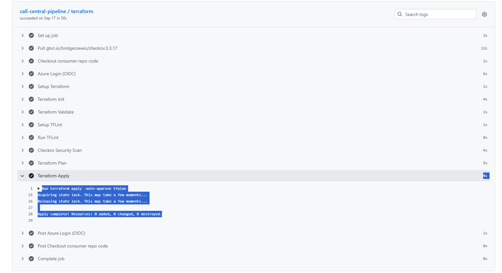
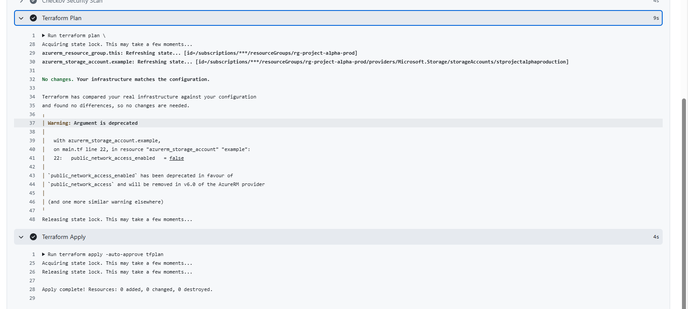
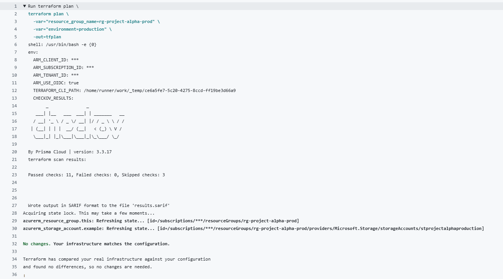

# project-alpha-infra

Azure infrastructure for Project Alpha, deployed via Terraform.

This repo contains **no deployment pipeline logic of its own**. CI/CD is handled entirely by `omni-tech-devops-library`, a central reusable GitHub Actions workflow shared across all Omni-Tech project repos. See [omni-tech-devops-library](https://github.com/azimkayz/omni-tech-devops-library) for what the pipeline actually does, its guardrails (Checkov, TFLint, pinned Terraform version), and how to configure a new consumer repo.

## Structure

```
.github/workflows/deploy.yml   # thin caller — passes this project's inputs to the central workflow
infra/
  backend.tf                   # remote state config (shared azurerm backend)
  variables.tf                 # input variable declarations
  main.tf                      # this project's actual Azure resources
```

## What gets deployed

- An Azure Resource Group (`rg-project-alpha-prod`)
- A Storage Account (`stprojectalpha<environment>`), hardened per the central pipeline's Checkov policy: TLS 1.2 minimum, public access disabled, shared-key auth disabled, soft-delete enabled, geo-redundant (GRS) replication

## Pipeline

Every push to `main` or pull request triggers [`deploy.yml`](.github/workflows/deploy.yml), which calls the central workflow with this project's `resource_group`, `environment`, and `working_directory`. `terraform apply` only runs on pushes to `main` (not on pull requests, which only get a `plan`).

## Required repo secrets

Configured under **Settings → Secrets and variables → Actions**:

- `AZURE_CLIENT_ID`
- `AZURE_TENANT_ID`
- `AZURE_SUBSCRIPTION_ID`

These correspond to an Azure AD App Registration with a federated credential scoped to this repo (`repo:azimkayz/project-alpha-infra:ref:refs/heads/main`), granted Contributor on `rg-project-alpha-prod` and Storage Blob Data Contributor on the shared Terraform state storage account.

## GitHub Actions Execution Evidence

The following screenshots provide evidence of the GitHub Actions workflow execution and its validation, security scanning and Terraform deployment stages.

### 1. Successful GitHub Actions Workflow



### 2. Terraform Plan and Apply



### 3. Checkov Security Scan



The Checkov scan reported 11 passed checks, 0 failed checks and 3 skipped checks. Terraform Plan reported that no changes were required. Terraform Apply completed with 0 resources added, 0 changed and 0 destroyed.

## Discovery Summary

During this assignment, I discovered how GitHub Actions reusable workflows can help organisations centralise and standardise their CI/CD pipelines. Instead of maintaining 15 separate Terraform deployment workflows, Omni-Tech can store common deployment logic in one central repository and allow individual project repositories to call it using `workflow_call`.

I learned how inputs and secrets allow each project to provide its own configuration while sharing the same deployment process. This approach reduces duplicated code, simplifies maintenance, improves consistency, and makes it easier to enforce security checks such as TFLint and Checkov across multiple projects.